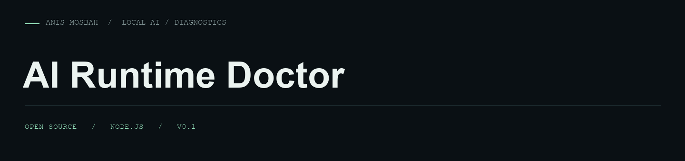
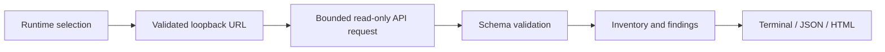

# AI Runtime Doctor

### Know what your local AI runtime is actually doing.

**Node.js 22+** · **MIT** · **v0.1.0** · [API](index.mjs) · [Tests](project.test.mjs)

A read-only CLI and JavaScript API for diagnosing **Ollama** and **LM Studio** before you debug the application built on top of them.

When a local AI feature stops working, first establish whether the server responds, which models it exposes and whether Ollama has a model loaded. Save a portable report without sending a prompt or loading a model.

## What it checks

| Capability | Behavior |
| :--- | :--- |
| Local runtime discovery | Checks the two supported default endpoints independently. |
| Model inventory | Names, reported disk size, family and quantization where supplied. |
| Ollama loaded models | Reported VRAM usage and context length where available. |
| Network boundaries | Loopback-only endpoints; redirects are rejected. |
| Failure diagnosis | Timeouts, invalid JSON, incompatible schemas and empty inventories. |
| Portable output | Terminal, JSON, Markdown and standalone HTML. |

## Run

```sh
git clone https://github.com/anistack72/ai-runtime-doctor.git
cd ai-runtime-doctor
node cli.mjs
node cli.mjs --runtime ollama --format json > runtime-report.json
node cli.mjs --runtime lmstudio --timeout 5000 --format html > runtime-report.html
```

Requires **Node.js 22+**. There are no runtime dependencies. This package is distributed from source; it has not been published to npm.

## Use from JavaScript

```js
import { diagnose } from './index.mjs';

const report = await diagnose({ runtime: 'ollama', timeout: 2500 });
console.log(report.runtimes[0].models);
```



## Report contract

`schemaVersion: 1` includes `checks`, `runtimes`, `host` and a run timestamp. Individual runtime reports contain `models`, `runningModels` and `latencyMs`. Latency measures the **model-list request**, not inference performance. Host data is limited to platform, architecture and total memory; hostname and account name are omitted.

Exit codes: **0** no failed checks, **1** failed checks, **2** invalid usage or tool error. `--strict` also fails on warnings. In automatic discovery mode, one working runtime is enough; an absent optional runtime becomes a warning.

## Boundaries

No prompts, chat history, API keys or credentials are read. No inference, download or model-loading endpoint is called. Authentication-protected servers are reported as unavailable; this release does not accept tokens. Only root endpoints on `127.0.0.1`, `localhost` and `[::1]` are accepted. A local model endpoint does not prove the rest of an application is offline or private.

The HTTP response cap is 2 MiB. Request and body reading share the configured timeout.

## References

Endpoint adapters follow [Ollama model listing](https://docs.ollama.com/api/tags), [Ollama running models](https://docs.ollama.com/api/ps) and [LM Studio model listing](https://lmstudio.ai/docs/developer/openai-compat/models). This project is independent of those vendors.

## Reproducible demonstration

```sh
node demo.mjs
node demo.mjs html > demo-report.html
```

The demo is explicitly labeled **synthetic**. It uses temporary local data or controlled fixture responses, never a third-party target. The generated HTML is standalone, with no remote scripts, fonts or analytics.

## Development

```sh
npm run check
npm test
```

Tests use local fixtures and local HTTP servers. The included CI matrix targets Node.js 22 and 24 on Linux, macOS and Windows. A local test pass does not mean that every CI platform has already run.

See [CONTRIBUTING.md](CONTRIBUTING.md) for changes and [SECURITY.md](SECURITY.md) for private security reports.

---

Built by **Anis Mosbah** · [Professional enquiries](mailto:contact@anis-mosbah.dev) · [MIT license](LICENSE)
